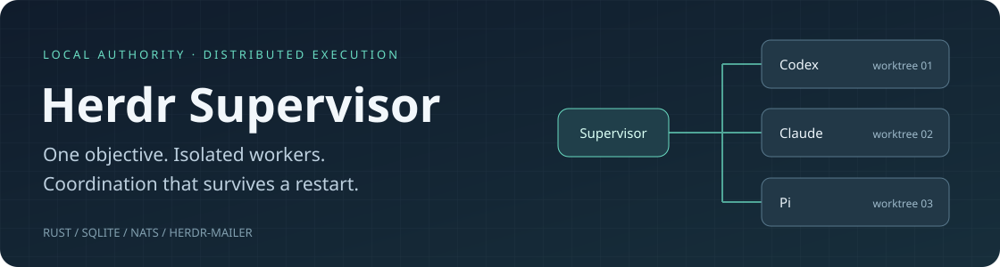
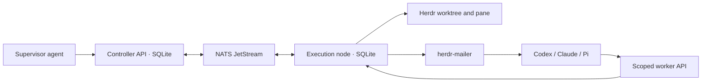

<p align="center"></p>

# Herdr Supervisor

A Rust adaptation of [Herdr Projects](https://github.com/eliasstravik/herdr-projects) for supervising coding agents across isolated Git worktrees. Herdr owns the workspaces and panes, **herdr-mailer delivers messages to native sessions**, and a SQLite controller owns task contracts, permissions and decisions. NATS JetStream carries coordination between the controller and execution nodes.

**In development.** The controller, signed node protocol, curated memory, scoped worker API, native worker launch/stop path and code review/integration pipeline are implemented. Projects can now display a bound controller run and submit scoped lifecycle/memory actions. Projects can also request an owned Codex, Claude or Pi coordinator through a configured controller launcher. Artifact verification, broader onboarding, recovery and cleanup remain in progress. The full delivery contract is in [IMPLEMENTATION.md](IMPLEMENTATION.md).

## What is different

- **An assignment is a contract.** Each attempt binds a task revision, base commit, node, runtime, session UUID and epoch. Old sessions cannot submit new decisions after cancellation.
- **Retries preserve identity.** State, operation receipts and outgoing intents commit together. A lost creation or launch response triggers inspection of the intended resources, never a blind second launch.
- **Delivery has distinct receipts.** Broker storage, controller application, native runtime submission and a model's readiness/result are separate facts.
- **A result does not free a process slot.** The pane wrapper waits for its native process and persists an exit receipt. The node reports it to the controller before capacity is released. Cancellation fences credentials immediately; a missing exit receipt remains uncertain.
- **Review targets the actual integration candidate.** The controller combines the author's commit with the current integration base, runs configured checks in a separate checkout and assigns an independent reviewer to that exact candidate. Integration advances an owned branch with a compare-and-swap operation.
- **Memory is curated.** Workers propose text with evidence; the supervisor approves or withdraws revisions. Each assignment carries a bounded selection of approved topics.
- **Local execution uses the node protocol.** Moving an executor to another host changes connectivity and repository mappings, not task ownership. NetBird can supply private connectivity; signed records and broker ACLs still enforce application routes.

## Try the controller locally

Requires Nix with flakes enabled. These commands create isolated state and do not install a plugin, change agent configuration or start a model:

```bash
nix build .#herdr-supervisor
state_dir=$(mktemp -d)
./result/bin/herdr-supervisor control --state "$state_dir" init
./result/bin/herdr-supervisor control --state "$state_dir" serve
```

Initialization writes `control.sqlite`, an owner key and a private `admin.token` file. It prints the credential **path**, not the token. The API listens on `control.sock` inside that directory. Repeating initialization preserves the existing identity.

Use `control --help` for controller and node commands. A mutation is a JSON document with `method` and `params`, submitted with a stable operation ID:

```bash
./result/bin/herdr-supervisor control --state "$state_dir" apply \
  --credential "$state_dir/admin.token" \
  --operation create-first-run --request create-run.json
```

See [operations](docs/operations.md) for the request shape, node enrollment and executor configuration. Runtime execution also requires Herdr, the selected agent CLI, a private NATS broker and herdr-mailer with protocol-2 idempotent sends and recipient preconditions. Those services are not started by `nix build`.

## Runtime behavior

| Runtime | Launch and delivery | What acceptance establishes |
| --- | --- | --- |
| Codex | Auto-review with `workspace-write`; UUID observed on the owned Herdr pane; mailer uses native queue | Queue submission, followed separately by a worker readiness event |
| Claude Code | Explicit development-channel opt-in; assigned UUID; mailer's MCP channel bridge | Channel write; Claude provides no delivery ACK |
| Pi | Assigned UUID; mailer's extension and `sendMessage` | API submission; not model completion |

A worker receives its assignment only after the controller accepts the exact resource binding. Its private API/CLI/MCP permits reading its contract and selected memory, reporting readiness/results, proposing memory and inspecting its own event receipts. A reviewer receives the exact candidate and reports criterion-by-criterion findings through the same scoped transport. Neither role can dispatch agents, approve memory or alter run policy.

An existing native coordinator session on the controller host can be attached with `control connect-supervisor`. It receives durable notices through mailer and reads current state through `control context` or `supervisor_context`. Replacing it revokes its previous capability; pending notices never change recipients. See [coordinator setup](docs/operations.md#connect-a-native-coordinator).

Use `managed attach` to connect a fresh Projects folder to that run. Its popup then shows authoritative tasks, attempts, notices and memory; actions carry explicit revisions, and legacy scheduling is blocked for that project. See [Projects setup and keys](docs/operations.md#attach-the-projects-view). With an owner-approved `--launch-config` and the controller notifier enabled, `open` reserves and starts a coordinator using a run-authorized profile. Subsequent opens report pending launches or focus the exact registered session. An unresolved launch is never silently replaced.

The launch tests execute harmless stub processes and use fake Herdr/mailer responses alongside real Git and Unix sockets. They do **not** prove authenticated model processing. See [validation](docs/validation.md) for evidence and current gaps.

## Architecture



Owner and node identities use Ed25519 `did:key`. Signed, versioned JSON records borrow ideas from ATProto. This is a private protocol: no federation, PDS, repository sync or ATProto wire-compatibility claim.

Worktrees isolate Git checkouts. Credentials and private state operate within a trusted same-UID environment; they are not an OS boundary against hostile processes running as that user.

## Memory and persistence

The controller stores proposals and revisions in `control.sqlite`, with WAL journaling, foreign keys and full synchronization. Approval records the author, evidence, source attempt and approving principal. Withdrawal creates a new revision without deleting history. Dispatch includes only requested topics plus preferences, with at most 32,000 UTF-8 bytes of text.

Memory currently belongs to a **run**. Cross-run project memory and Markdown exports are not implemented. Agent transcripts remain with their runtimes. NATS transports events; it does not replace the controller database.

## Development

The flake follows **numtide/blueprint** with `prefix = "nix"`. Cargo dependencies are locked; the Nix package runs the test suite offline, including isolated real NATS tests.

```bash
nix develop
just test
just lint
nix fmt
nix build .#herdr-supervisor
nix flake check
```

When running Cargo outside the devshell, set `NATS_SERVER` to a `nats-server` executable. Broker tests are mandatory and do not silently skip when it is missing. The validated platform is `x86_64-linux`; other declared targets need their own build evidence.

## Origins and documentation

Adapted from Herdr Projects at `4e4548c3c43888e6be1c96906215998f07dc63f0`, preserving its MIT license and attribution in [NOTICE](NOTICE). The original [README](docs/upstream/README.md) and [operations guide](docs/upstream/operations.md) describe the inherited implementation, not guarantees of the managed controller.

- [Operations](docs/operations.md): state, credentials, API and node setup
- [Validation](docs/validation.md): tested behavior and remaining work
- [Design](docs/supervisor-design.md): architectural contract
- [Projects assessment](docs/projects-assessment.md): reuse decisions and baseline findings

No public fork release or deployment is implied by this local implementation.
