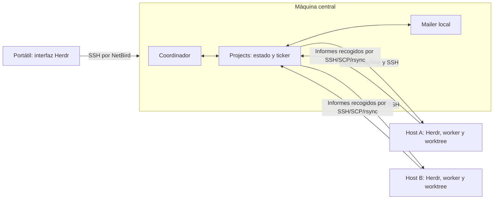

# Herdr Projects como base de nuestro supervisor

Estudio del 4 de octubre de 2026. Revisión upstream **4e4548c3c43888e6be1c96906215998f07dc63f0**, versión del manifiesto **0.2.34**. `git ls-remote` confirmó el mismo HEAD al comenzar. Mailer se revisó en **903df1d**, con implementación equivalente a 96efe7b.

## Decisión

**Sí usaría herdr-projects como base del producto, mediante una adaptación mantenida y acotada. No lo adoptaría sin cambios como sustituto del motor autónomo que habíamos diseñado.** Ya ofrece la experiencia de coordinador, tareas, worktrees, informes, memoria y máquinas remotas. Nos ahorra construir esa superficie. Sin embargo, los límites duros, la identidad exacta de ejecución, el registro previo de efectos y la aceptación de resultados por contrato requieren trabajo adicional.

La primera fase puede funcionar en una sola máquina. La implementación ya tiene un camino SSH para añadir ejecutores remotos sin trasladar el proyecto completo a cada host. La topología adecuada es **un centro de coordinación y varios ejecutores**, con el centro en una máquina que permanezca encendida cuando queramos continuidad. No hace falta federación.

La revisión encontró además un fallo reproducible que debe corregirse antes de coordinar varios proyectos en un mismo host remoto: el intervalo de consulta se consume globalmente por máquina, pero cada consulta procesa solo los threads de un proyecto. El primer proyecto puede impedir que los demás se consulten.

Esta conclusión sustituye la recomendación provisional de la [ampliación anterior](ecosystem-expansion.md). Los contratos de [supervisor-design.md](supervisor-design.md) siguen siendo criterios de aceptación; la UI y el modelo de proyecto pueden proceder de Projects.

## Qué se comprobó

Se leyeron las rutas de creación, lanzamiento, entrega, ticker, recuperación, persistencia, perfiles, SSH, copia, limpieza y tareas. Se compiló el proyecto y se ejecutaron pruebas upstream y reproducciones independientes en un checkout temporal. Herdr instalado responde **0.9.1**; su ayuda confirma `machine add --label ... --remote-session ...`.

| Comprobación | Resultado | Qué demuestra |
| --- | --- | --- |
| Suite upstream, sin modificar | 324 unit tests pasan; 1 falla; la fase CLI no llega a ejecutarse | Fallo de cancelación de grupos por `/bin/kill` inexistente en este NixOS |
| Siete pruebas independientes | 7 pasan | Reproducen seis límites/fallos concretos y una negativa segura de recuperación; no significa que los fallos estén corregidos |
| Sustitución temporal de `/bin/kill` por `kill` de PATH | 332 unit tests y 4 CLI pasan | La suite completa, incluidas las siete reproducciones, funciona con esa corrección de portabilidad |
| Reproducción remota mediante el ticker completo | Pasa; 65 ticks simulados, 17 consultas, todas del primer proyecto | El segundo proyecto no recibe consultas ni lanza su trabajador mientras el primero sigue activo |

Las evidencias y los comandos están en [research/projects-depth/evidence.md](research/projects-depth/evidence.md). No se lanzaron modelos ni se conectaron hosts del usuario. Las pruebas remotas usan el `Runner` simulado upstream; no equivalen a una prueba extremo a extremo sobre dos máquinas ni sobre NetBird. No se instaló Projects ni se aplicó configuración NixOS.

## Arquitectura existente

Projects es un único binario Rust con CLI, popup y ticker. El coordinador es una sesión ordinaria de agente con instrucciones y herramientas; no un planificador LLM embebido en el binario. Los subcomandos ejecutan operaciones mecánicas. La separación coincide bastante con la que buscábamos.

| Área | Implementación | Implicación para reutilizarla |
| --- | --- | --- |
| Proyecto y persistencia | `project.rs`, `paths.rs`; carpetas, Markdown/TOML/JSON, locks de proyecto | Conservar proyecto, preferencias e interfaz de archivos; definir con precisión la autoridad sobre ejecuciones |
| Planificación conversacional | `skill/COORDINATOR.md`, `coordinator.rs` | Reutilizar el coordinador visible; adaptar las instrucciones a nuestros contratos y a mailer |
| Tareas | `tasks.rs`, `assign.rs`; parser de `TASKS.md`, perfiles y máquina propietaria | Backlog útil; no es un DAG con dependencias y reservas transaccionales |
| Workers | `threads.rs`, `thread.rs` | Creación/adopción/reapertura de recursos Herdr e informes; buen punto de partida |
| Arranque y entrega | `ticker.rs`, `brief.rs`, `prompt_box.rs` | Hay recuperación de terminal; añadir vía nativa y recibos explícitos |
| Remoto | `remote.rs`, `Herdr::on_machine`, `ticker::remote_pass` | Dos vías coordinadas: CLI Herdr y SSH directo; ambas deben apuntar al mismo host |
| Interfaz | `popup.rs`, `sidebar.rs`, `grouping.rs`, `actions.rs` | Reutilización directa de vistas y acciones, sin construir otra TUI |
| PR y limpieza | `pr.rs`, `steps.rs`, `threads.rs`, `sweep.rs` | Conserva informes y evita limpieza forzada; ampliar aceptación por SHA y recuperación |

No encontré una interfaz pública de extensiones del propio Projects para sustituir entrega o scheduler. Sus módulos se compilan en un binario. Un wrapper externo puede añadir avisos, pero modificar de forma fiable arranque, idempotencia y reparto remoto requiere cambios internos o puntos de extensión upstream. **Un adaptador mailer es una modificación concreta del proyecto, no un plugin ya disponible.** [Código upstream](https://github.com/eliasstravik/herdr-projects/tree/4e4548c3c43888e6be1c96906215998f07dc63f0/src).

### Ciclo de una tarea

1. El coordinador lee `context`, decide una tarea y llama a `thread start`.
1. `start` comprueba estado y perfil, asigna un ID `t-NNNN`, escribe la tarea y pide a Herdr un worktree. La base suele conservarse como referencia Git, no siempre como SHA inmutable.
1. Graba los IDs de workspace/tab/pane y la ruta. Compone el brief con instrucciones, memoria y tarea. El thread queda `Open` con `prompt_pending`.
1. El ticker inicia el agente en una pasada posterior. Espera disponibilidad y una entrada de terminal adecuada; entrega el brief.
1. El worker reescribe `report.md`. El ticker detecta cambios, copia resultados al proyecto y deja eventos en el inbox.
1. El coordinador revisa, continúa o resuelve. Los eventos de PR y las rutinas pueden producir más trabajo.

`Starting`, `Open`, `Failed` y `Resolved` son estados persistidos; `Working`, `Ready for review`, etc. son agrupaciones observadas para la interfaz. Es una distinción útil. Sin embargo, `Resolved` no representa necesariamente «contrato verificado y commit integrado»: también existe resolución manual o por inactividad. [Threads](https://github.com/eliasstravik/herdr-projects/blob/4e4548c3c43888e6be1c96906215998f07dc63f0/src/threads.rs), [modelo](https://github.com/eliasstravik/herdr-projects/blob/4e4548c3c43888e6be1c96906215998f07dc63f0/src/thread.rs).

### Persistencia y recuperación

Las escrituras del binario usan lock de proyecto y fichero temporal con `sync_all` y rename. Esto evita lecturas parciales de un archivo. **No proporciona una transacción única entre varios archivos y la operación remota.** La función tampoco sincroniza el directorio después del rename. Los Markdown que edita directamente el agente no pasan necesariamente por estos locks. [Persistencia](https://github.com/eliasstravik/herdr-projects/blob/4e4548c3c43888e6be1c96906215998f07dc63f0/src/project.rs).

Hay mecanismos prudentes: si un arranque quedó a medias, no elimina automáticamente los recursos; `restart` puede reutilizar un pane o reabrir el worktree. Si no guardó la ruta pero ya existe la rama, exige inspección en lugar de recrearla ciegamente. Esa negativa se comprobó. La recuperación conserva el trabajo Git y reconstruye contexto desde el informe; el registro del worker no fija su sesión nativa anterior como lo hace nuestro enrutamiento UUID/epoch.

El ticker es un proceso en segundo plano, separado con `setsid` y lock por raíz. Sale tras cinco minutos sin sesiones alcanzables; no es un servicio distribuido que siga coordinando aunque desaparezca el Herdr central. Un servicio supervisado puede reiniciarlo, pero no reconstruye por ello todas las sesiones ni la autoridad de un coordinador. [Ticker](https://github.com/eliasstravik/herdr-projects/blob/4e4548c3c43888e6be1c96906215998f07dc63f0/src/ticker.rs).

## Varias máquinas: qué hay realmente



La parte Projects/SSH existe; la unión con mailer del diagrama es propuesta. El portátil y la máquina central pueden ser el mismo equipo al principio.

### Secuencia remota implementada

- El centro selecciona una máquina guardada en Herdr y un repositorio que ya existe allí. La selección es explícita por `--machine` o por la configuración de tarea/repositorio; no hay un scheduler que escoja automáticamente el host con recursos disponibles.
- Por SSH ejecuta `herdr-projects profile resolve` en el destino. El perfil y sus argumentos pertenecen a esa máquina; el centro comprueba que el nombre esté permitido.
- Por SSH consulta el repositorio y su base. Puede hacer `git fetch origin`; el fallo del fetch no impide continuar con las referencias disponibles.
- Con `herdr --machine <label> worktree create` crea el checkout y la interfaz remotos. Escribe el brief por SSH y guarda la ubicación en el centro.
- El ticker usa `herdr --machine ... agent start`, observación de panes y entrega del brief. No necesita un coordinador Projects independiente en cada ejecutor.
- Recoge hashes de informes por SSH, archivos por SCP y bibliotecas con `rsync -rt`. Hay comprobaciones de symlinks y un límite de 50 MiB para copiar la biblioteca. Los uploads del centro no se copian automáticamente al worker remoto.

Fuentes: [remote.rs](https://github.com/eliasstravik/herdr-projects/blob/4e4548c3c43888e6be1c96906215998f07dc63f0/src/remote.rs), [adaptador Herdr](https://github.com/eliasstravik/herdr-projects/blob/4e4548c3c43888e6be1c96906215998f07dc63f0/src/herdr.rs), [operaciones remotas](https://github.com/eliasstravik/herdr-projects/blob/4e4548c3c43888e6be1c96906215998f07dc63f0/docs/operations.md#threads-on-other-machines).

No proporciona aprovisionamiento completo de máquinas, clones Git iniciales, credenciales de modelos ni herramientas de compilación. Tampoco transporta los commits de vuelta por el hecho de copiar `report.md`: para integrar código hace falta un remoto Git/PR o un mecanismo explícito de transferencia y verificación de objetos.

### Desconexiones y latencia

Las consultas remotas normales se programan cada cuatro ticks; el bucle espera 15 segundos después del trabajo, por lo que «un minuto» es aproximado. Los hosts se procesan secuencialmente. SSH tiene `BatchMode=yes`, `ConnectTimeout=5` y deadlines externos; las copias pueden tardar hasta 60 segundos por operación. Un host lento puede aumentar la duración del ciclo.

Si una consulta remota falla, conserva el último estado y omite ocho ticks antes de reintentar. Tras diez minutos de fallo observado genera un aviso y después otro de recuperación. Esos contadores de salud están en memoria del ticker. **«Working» durante una desconexión puede ser el último estado conocido, no actividad recién comprobada.** Existe además una pasada rápida de briefs para agentes recién lanzados. [Memoria y cadencia](https://github.com/eliasstravik/herdr-projects/blob/4e4548c3c43888e6be1c96906215998f07dc63f0/src/steps.rs), [pasadas](https://github.com/eliasstravik/herdr-projects/blob/4e4548c3c43888e6be1c96906215998f07dc63f0/src/ticker.rs).

Si el centro se apaga, los procesos remotos pueden continuar si su servidor Herdr persiste; la planificación, recogida y coordinación central se detienen. Por eso escogería un centro siempre encendido cuando pasemos del primer equipo. No hay elección automática de otro coordinador ni soporte activo-activo de la raíz de Projects; no compartiría esa carpeta por NFS/Syncthing para intentar conseguirlo.

### Encaje con NetBird

Projects llama a OpenSSH; NetBird puede aportar conectividad privada y nombres/IP alcanzables. Para automatización continuada escogería un acceso SSH no interactivo probado desde el usuario que ejecuta el ticker. No necesita un adaptador NetBird específico.

Hay que distinguir OpenSSH sobre la red NetBird del servidor SSH integrado de NetBird: este último puede exigir autenticación OIDC y tiene opciones separadas para SFTP y forwarding. Una sesión interactiva que funciona no prueba que `ssh -o BatchMode=yes`, SCP, rsync y el transporte de Herdr funcionen desatendidos. No propongo desactivar autenticación para resolverlo. [NetBird SSH](https://docs.netbird.io/manage/peers/ssh), [máquinas Herdr](https://herdr.dev/docs/connecting-machines/).

Ejemplo de configuración futura, no ejecutado en el host:

```sh
herdr machine add aldo@builder --label builder --remote-session agents
herdr-projects new mailer --repo /srv/repos/herdr-mailer@builder
herdr-projects open mailer
herdr-projects thread start mailer --title "Revisar transporte" \
  --repo /srv/repos/herdr-mailer --machine builder --profile codex \
  --task-file task.md
```

Los comandos muestran las superficies existentes, no un bootstrap completo. El destino necesita versiones compatibles, repositorio, perfil, autenticación y entorno. `machine add` prepara el servidor remoto: no es una consulta inocua y no se ejecutó durante el estudio.

## Hallazgos que condicionan la adopción

| Hallazgo | Evidencia | Consecuencia / cambio necesario |
| --- | --- | --- |
| **Un host remoto compartido queda monopolizado por el primer proyecto** | Prueba independiente con el ticker completo: 17 consultas de alpha, ninguna de beta | Bloqueante para varios proyectos remotos. Consultar por host y distribuir la observación a todos los proyectos, o separar la cadencia por proyecto/host conservando la salud del host |
| **El máximo de threads es orientativo** | Con límite 1, dos llamadas idénticas crean dos threads y dos worktrees | Convertir capacidad en una reserva comprobada bajo lock/transacción; agregar límites por host y globales |
| **No hay ID de operación para `thread start`** | Repetir el mismo encargo asigna otro `t-NNNN` | Registrar intención y deduplicar solicitudes antes de efectos; un timeout debe reconciliarse |
| **La sesión nativa no determina la identidad del worker** | Cambiar sesión y terminal conservando pane/cwd/kind/nombre sigue haciendo match | Añadir identidad de intento, sesión y generación; mantener la adopción legítima como operación explícita |
| **El follow-up se registra después de enviarse** | Inyección simulada exitosa seguida de fallo al escribir task.md | Hay una ventana en que el receptor recibió texto sin registro durable. Se necesita intención/outbox y estado ambiguo |
| **Timeout de comprobación remota se trata como rama ausente** | `remote::branch_exists` devuelve `Ok(false)` ante timeout | Distinguir encontrado/ausente/desconocido antes de decidir recreación |
| **Un registro TOML corrupto desaparece del inventario** | `load` falla pero `list` lo omite silenciosamente | Mostrar error de estado y bloquear decisiones de capacidad/limpieza dependientes; no darlo por inexistente |
| **Ruta `/bin/kill` incompatible con este host** | Suite upstream falla; corrección temporal permite pasar suite completa | Parche upstream o sustitución fijada en el paquete Nix; no crear rutas globales ad hoc |

Los límites de capacidad son deliberadamente instrucciones al coordinador en la skill upstream; no los presento como una promesa rota del autor. La identidad flexible también facilita restauración nativa. Son diferencias respecto a nuestro contrato. El fallo de reparto remoto y el de portabilidad sí son defectos reproducidos. [Política del coordinador](https://github.com/eliasstravik/herdr-projects/blob/4e4548c3c43888e6be1c96906215998f07dc63f0/skill/COORDINATOR.md).

Otros límites comprobados por lectura:

- Hay varios coordinadores posibles en una carpeta y el ticker elige a cuál avisar. No hay un mandato exclusivo con generación para decisiones de tarea. Al principio impondría un coordinador activo por proyecto desde el motor.
- El backlog Markdown no tiene dependencias ejecutables, presupuesto de coste ni resultado autenticado ligado a tarea/intento/revisión/SHA. `Ready for review` es una señal de interfaz, no una aprobación.
- Projects verifica la rama/repositorio de una PR y comprueba el tip antes de borrar una rama ya integrada. Esa comprobación y `git branch -D` son operaciones separadas; nuestro criterio de actualización por SHA esperado sigue siendo más estricto.
- La función de escritura de cada archivo y el claim temporal del brief no equivalen a un journal transaccional completo de efectos ni a fencing de propietarios. No se debe extender su lock local a varias máquinas como si fuera un protocolo de consenso.
- El modo `yolo` añade bypass de permisos para Codex/Claude. `start_threads=auto` y un perfil de ejecución autorizado son decisiones separadas: no es necesario activar yolo para querer delegación automática.

También hay buenas defensas que conviene conservar: no fuerza la retirada de worktrees sucios; una copia final fallida frena resolución salvo override explícito; un worktree parcial con rama existente requiere inspección; los perfiles se comprueban de nuevo antes del arranque; una máquina inalcanzable no dispara automáticamente un worker sustituto. Las pruebas upstream cubren estas rutas.

## Integración concreta con mailer

### En una máquina

Reutilizaría Projects y añadiría un límite explícito entre planificación y ejecución. El coordinador solicita operaciones; el binario comprueba capacidad, revisiones y autorización. El orden propuesto es:

1. Guardar la intención de crear un intento, con ID de operación, base SHA, perfil y host.
1. Reconciliar/crear el recurso Herdr y registrar su identidad.
1. Preparar el registro mailer y lanzar el runtime con configuración específica del intento.
1. Esperar un recibo funcional del worker; aceptar el arranque del proceso no basta.
1. Enviar avisos mediante una outbox y recoger resultados estructurados. El coordinador consulta la revisión vigente.
1. Verificar el commit y contrato antes de aceptar o integrar.

El launcher no se puede resolver solo añadiendo un notifier: `profiles::Entry` describe kind/modelo/argumentos y `agent.start` lanza un kind Herdr. Nuestra entrega Claude/Pi necesita configuración y credenciales de la sesión. Haría un adaptador de arranque específico por intento, sin reemplazar globalmente los ejecutables `claude`, `codex` o `pi`. Los puntos de intervención son `threads::start`, `ticker::launch_pass`, `brief::deliver`, `threads::prompt` y `steps::nudge`.

Mantendría las vistas, proyecto y memoria de Projects. Para ejecución autónoma, usaría una autoridad transaccional de intentos/operaciones; los datos que la UI necesite se consultarían o proyectarían desde ella. **No mantendría el estado de una misma tarea simultáneamente en dos motores que puedan decidir.** La incorporación de SQLite puede ser incremental, pero el contrato y la migración tienen que preceder a la escritura dual.

Mailer continúa siendo autoridad de mensajes, sesiones y recibos. No se consulta ni modifica su base directamente. Persisten los huecos ya conocidos: idempotencia de envío elegida por el cliente y precondiciones explícitas de destinatario para reintentos. Además, `native:accepted` y `channel_written` no son una respuesta del modelo. Véanse [viabilidad](supervisor-feasibility.md) y [runtimes nativos](native-runtimes.md).

### En varias máquinas

**No hace falta NATS para la primera fase remota.** Projects ya usa SSH para ejecutar y recoger resultados. Se puede mantener ese recorrido y usar mailer local en el centro para despertar al supervisor cuando llegan informes. Para inyección nativa en workers remotos hace falta un helper en el host que registre y entregue a su mailer local, y un protocolo explícito de resultados/errores hacia el centro. Es una adaptación propuesta, no una función existente.

NATS puede aportar avisos inmediatos y reconexión durable más adelante. Pero nuestro mailer actual **no se convierte en un sistema multihost por apuntar dos daemons al mismo broker**:

- Cada inicialización crea un owner; `Receive` rechaza otro owner.
- No hay aprovisionamiento de nodos, delegación de autoridad ni directorio remoto de sesiones.
- Las suscripciones se crean para los agentes registrados localmente. Dos daemons con el mismo consumidor durable repartirían mensajes, no mantendrían copias sincronizadas.
- La ruta de destino se fija con la sesión local conocida; compartir nombres no sincroniza epochs ni ubicaciones.
- Los replies necesitan el ask original persistido para su autorización.

Fuentes propias: `internal/identity/identity.go`, `internal/store/store.go`, `internal/daemon/daemon.go`, `internal/transport/nats.go` y [operaciones](operations.md). No copiaría `owner.json` con la clave privada y el token administrador a todos los workers para eludir estas diferencias.

La evolución deberá definir **host ID, agente lógico, sesión nativa, epoch y propietario de la entrega**, registro central de rutas, credenciales de host y un solo consumidor activo por destinatario. Los gateways pueden mantener mailer local como frontera y transportar eventos de coordinación por SSH primero o NATS después. Las particiones dejan intentos en estado desconocido; no liberan capacidad ni autorizan duplicados hasta reconciliar.

## Ruta de adopción y alternativas

| Ruta | Ventaja | Coste | Recomendación |
| --- | --- | --- | --- |
| Projects upstream sin cambios | Primera experiencia más rápida; remotos ya diseñados | Contratos débiles para autonomía, errores encontrados, entrega por terminal | Útil para piloto atendido tras corregir portabilidad; no basta para nuestro objetivo completo |
| Projects adaptado, con mailer y autoridad de ejecución | Reutiliza interfaz, SSH, perfiles, informes y lifecycle | Cambios internos, migración y pruebas de recuperación; mantener diferencia upstream | **Preferida** si acordamos preservar esa base y limitar el fork |
| Supervisor nuevo completo | Control total del contrato desde el inicio | Rehacer mucha superficie ya existente | Reserva si la adaptación exige sustituir casi todo el modelo o upstream resulta difícil de mantener |

No asigno porcentajes de reutilización ni una estimación de días sin prototipo: el coste difícil está en la migración de autoridad, no en los wrappers CLI. La licencia upstream es MIT; permite una adaptación manteniendo atribución. No se ha publicado un fork, issue o PR durante este estudio.

### Fases con criterios de salida

**Fase 1: piloto local reproducible.** Fijar Projects en Nix, resolver portabilidad, un coordinador, uno o dos workers y revisión humana de integración. Desactivar resolución por inactividad para el piloto. Verificar perfiles Auto sin yolo, conservación del Git y reanudación tras cerrar la interfaz. El paquete debe evitar el instalador global y controlar el PATH; `build.rs` usa hora de compilación y requiere una decisión explícita para reproducibilidad Nix.

**Fase 2: autonomía local con mailer.** Capacidad obligatoria, idempotencia de operaciones, sesión/epoch, outbox, recibo funcional y verificación de SHA/contrato. Ensayar caída antes/después de cada efecto, respuesta tardía y doble solicitud. Es la condición para reemplazar de verdad el motor que planeábamos, no solo su presentación.

**Fase 3: dos ejecutores por SSH/NetBird.** Corregir reparto por host/proyecto, identificar máquinas de forma estable y medir pérdida/recuperación de conectividad. Probar dos proyectos en el mismo host y uno en hosts distintos; cortes durante creación, arranque y copia; discrepancia de versiones; informe/commit retrasado. La política Git debe indicar cómo se transfieren commits al centro. No declarar compatible por haber pasado solo mocks.

**Fase 4: avisos remotos durables, si hacen falta.** Añadir gateway y enrolamiento, registro de rutas y outboxes; adoptar NATS cuando el polling SSH sea una limitación medida. Preservar una autoridad central para tareas y política. La sustitución automática del centro sería otra capacidad, no un efecto secundario de instalar NATS.

La elección permite empezar en una máquina y crecer manteniendo el modelo: **proyecto central, ejecuciones identificadas por host e intento, recursos Herdr locales al ejecutor y resultados verificables**. El trabajo inmediato de implementación sería una adaptación de Projects con puertas de aceptación concretas, no instalar varios coordinadores competidores.
