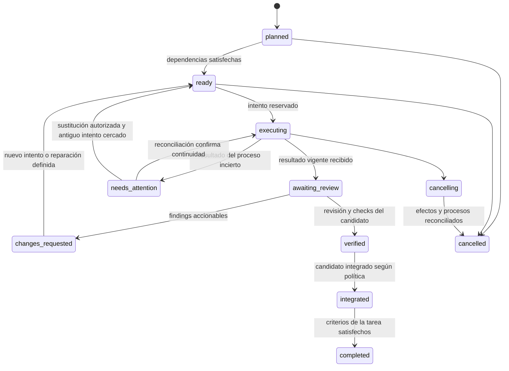

# Diseño propuesto del supervisor de Herdr

Estado: propuesta resultante del [estudio de viabilidad](supervisor-feasibility.md), 4 de octubre de 2026. Los nombres `herdr-supervisor`, herramientas, tablas y configuración de este documento son propuestos; no son comandos disponibles hoy.

La [ampliación de investigación](ecosystem-expansion.md) recomienda evaluar herdr-projects + mailer antes de implementar este motor. Los contratos de este diseño sirven también como criterios de aceptación para esa adaptación.

El [estudio profundo de Projects](herdr-projects-assessment.md) concreta esa adaptación, sus límites comprobados y una evolución de un host a ejecutores SSH. Este documento conserva los contratos exigidos; no implica construir una segunda autoridad de tareas junto a Projects.

## Responsabilidades

El sistema recibe un objetivo y unos límites. Una sesión de agente supervisor propone un plan y decide sobre hallazgos. El controlador valida esas decisiones, mantiene el estado y ejecuta efectos externos. Herdr proporciona las sesiones visibles y los worktrees. Mailer entrega avisos y preguntas. Git y las herramientas del proyecto proporcionan la evidencia de los cambios.

| Componente | Autoridad |
| --- | --- |
| Usuario y política de la ejecución | Objetivo, alcance permitido, perfiles y autorizaciones de integración/publicación |
| Supervisor LLM | Propuestas de tareas, interpretación de hallazgos, solicitudes de revisión y reparación |
| Controlador | Estados, dependencias, capacidad, credenciales de tareas, efectos pendientes y decisiones aceptadas |
| Herdr | Workspaces/panes/procesos observados y creación/apertura de worktrees |
| Git | Objetos, referencias, ancestros, árbol y estado del checkout |
| Mailer | Identidad de comunicaciones, mensajes, eventos de inbox y recibos de entrega |
| Verificador | Comandos ejecutados sobre un commit/entorno concreto y sus resultados observados |

Una tabla nunca sustituye a otra autoridad: el controlador no decide que un proceso existe porque lo pone en SQLite; consulta Herdr. Tampoco Herdr puede decidir que una tarea está aprobada porque el agente aparezca `done`.

## Estructura de implementación

Elegiría un único paquete Cargo al principio, con dos entrypoints: CLI/controlador y, cuando haga falta, TUI. Separación por módulos, sin convertir cada módulo en un servicio:

```text
src/
  domain/       estados, contratos, dependencias y reglas puras
  service/      casos de uso, scheduler y reconciliación
  store/        SQLite, migraciones, journal y outbox
  adapters/
    herdr/      cliente/socket, suscripciones, snapshots y capacidades
    mailer/     protocolo de mensajes y eventos
    git/        observación, candidatos e integración
    runtime/    perfiles y launcher local
    verifier/  procesos de validación y recibos
  api/          protocolo local y credenciales con ámbito
  cli/          comandos y presentación JSON
  mcp/          traducción de herramientas a los mismos casos de uso
  tui/          vista de estado, sin escribir directamente SQLite
```

Propuesta de dependencias: Tokio para sockets/timers/procesos; Serde para documentos; rusqlite en un actor escritor dedicado; clap para CLI; tracing para logs. Evaluar Ratatui cuando se construya la TUI. Versiones exactas y elección del SDK MCP quedan para la implementación y su lockfile. Ninguna librería sustituye las reglas de recuperación.

Un único proceso controlador por directorio de estado, con lock del sistema operativo y socket privado. La primera versión admite una ejecución activa por repositorio físico. No se divide por tarea en múltiples daemons. La UI es prescindible durante la ejecución. Mailer conserva su daemon; NATS solamente se inicia si el usuario configura el transporte opcional.

Las acciones del plugin pueden solicitar el arranque idempotente de ese controlador; un módulo Home Manager opcional puede mantenerlo como servicio de usuario. En ambos casos recibe una ruta explícita de estado y endpoint Herdr. No depende del cwd/foco del proceso que lo inició ni de variables de una sesión de shell desaparecida. Si Herdr no está disponible, espera y reconcilia; no lo inicia, actualiza o reinicia por su cuenta.

## Contrato con Herdr nativo

### Crear un trabajador

1. Resolver el repositorio físico y la base Git a un OID completo; comprobar capacidades de Herdr y la política de la ejecución.
1. Reservar capacidad y un intento en SQLite. Persistir la intención de crear el worktree con ruta y rama únicas antes de llamar a Herdr.
1. Invocar `worktree.create` con `cwd` absoluto, `branch`, `base` ya resuelta, `path`, `label` y `focus=false`.
1. Guardar los IDs que devuelva Herdr, nunca deducirlos. Verificar common-dir, rama, ruta y HEAD contra la intención.
1. Preparar bootstrap, capacidades y entorno del intento fuera del checkout. Lanzar el perfil, registrar su identidad nativa según el runtime y esperar el recibo funcional `worker.ready`.
1. Entregar por mailer un aviso que referencia el contrato vigente. El trabajador obtiene el detalle mediante `task.get` y registra que comienza el intento.

Solicitud conceptual al socket de Herdr, con identificadores de ejemplo:

```json
{
  "id": "op-create-42",
  "method": "worktree.create",
  "params": {
    "cwd": "/repos/project",
    "branch": "supervisor/run-42/task-3/attempt-1",
    "base": "0123456789012345678901234567890123456789",
    "path": "/worktrees/run-42/task-3-attempt-1",
    "label": "task-3 / attempt-1",
    "focus": false
  }
}
```

`id` correlaciona una respuesta; **no hay evidencia de que Herdr lo trate como clave idempotente de mutaciones**. Tras perder la respuesta, no repetir `worktree.create` a ciegas: reconciliar la ruta/rama únicas con `worktree.list`, Git y el snapshot. Si existe y coincide, adoptarlo como resultado de la operación; si no existe y se puede demostrar que el efecto no ocurrió, reintentar; si hay conflicto, `needs_attention`.

Para reabrir, usar `worktree.open` y respetar `already_open`: el panel devuelto puede contener un proceso existente. No dividir el panel del supervisor ni depender del foco actual.

### Arranque y entorno por runtime

`agent.start` inicia un ejecutable canónico en un panel disponible. No tiene un campo genérico para ejecutar nuestro launcher con un entorno por proceso. `worktree.create` tampoco ofrece `env` en 0.9.1. Estos límites deben formar parte del adaptador, no ocultarse tras una API supuesta.

Para Claude/Pi, usar un launcher propio en el panel de ese worktree. La CLI `pane run` envía un comando a la shell; no es una llamada arbitraria a `execve` ni aparece como método `pane.run` en el esquema del socket. Generar un comando fijo, con la ruta de un ejecutable Nix y un identificador/ruta privada correctamente citados. El launcher lee su configuración y ejecuta el runtime con `argv` y entorno explícitos. No interpolar el texto del objetivo, respuestas del agente o secretos en una shell.

| Runtime | Bootstrap propuesto | Prueba necesaria antes de `running` |
| --- | --- | --- |
| Codex | Lanzar perfil Auto autorizado; observar UUID nativo exacto; registrar en mailer; publicar credencial en la ruta prevista; enviar bootstrap por queue | Identidad nativa observada y recibo `worker.ready` desde la capacidad del intento |
| Claude | Preasignar UUID, registrar, persistir token/config; launcher de mailer con canal opt-in; misma UUID al reanudar | Puente conectado más recibo funcional; `channel_written` solo no basta |
| Pi | Preasignar UUID, registrar, persistir token/config; extensión empaquetada de mailer | Puente conectado más recibo funcional; `sendMessage` sin error solo no basta |

No asumir que Codex permite elegir el UUID con el mismo flag que Claude/Pi. El perfil instalado debe descubrirse y probarse. El launcher de Codex puede heredar rutas de credenciales que se rellenan antes del primer encargo; no se considera listo mientras falte la vinculación final. Un arranque ambiguo exige observación de la sesión prevista, nunca elegir “la última” conversación.

El entorno del hijo reemplaza las credenciales del padre por las del receptor, como exige el fix 96efe7b de mailer. Añade una capacidad diferente para la API del controlador: las credenciales de mailer no dan permiso de integrar código o aprobar resultados. Perfiles y permisos se seleccionan al crear la ejecución, sin preguntas repetidas por cada comando y sin convertir Auto en acceso irrestricto.

### Eventos, observación e interfaz

Mantener una conexión distinta para `events.subscribe`. La API normal responde una vez y cierra; se verificó contra 0.9.1. La suscripción de estado de agente requiere el `pane_id`. No hay cursor durable en `EventsSubscribeParams` del esquema inspeccionado.

Al arrancar o reconectar, suscribirse y reconciliar un snapshot, acumulando los avisos que lleguen durante la captura y volviendo a observar los recursos afectados. Tratar los eventos como pistas de cambio: pueden repetirse, llegar tarde o no describir toda la situación. Normalizar variantes de nombres documentadas por los clientes; tolerar eventos nuevos sin usarlos para mutar una tarea. Una desconexión de Herdr significa `unavailable`, no trabajador muerto.

La reconciliación determinista por plazos y comprobaciones de salud está permitida. Lo que se elimina es despertar al modelo periódicamente para preguntar si alguien terminó. Tampoco se debe suscribir al output completo de cada terminal para construir una segunda historia de conversaciones.

Mostrar fase/tarea/intento mediante metadata nativa, con secuencia y TTL cuando proceda. Reservar notificaciones para decisiones o fallos accionables. Las acciones del plugin invocan la misma API que CLI/MCP. Un panel propio añade vista global, acceso al worktree, commit revisado y motivo de bloqueo; no reemplaza los terminales que Herdr ya proporciona.

## Modelo persistente

Las siguientes son entidades y restricciones propuestas, no migraciones aplicadas. SQLite es la autoridad de coordinación; nadie escribe directamente en la base de mailer.

| Entidad | Campos principales | Restricción |
| --- | --- | --- |
| `runs` | ID, repo físico, objetivo, criterios, política/versiones, base OID, integración ref, estado, revisión | Una ejecución activa por repo en v1 |
| `tasks` | ID, run, contrato inmutable versionado, tipo, estado, revisión, prioridad | Criterios identificables; cambio de alcance crea nueva versión |
| `dependencies` | tarea, predecesora, condición | Mismo run, sin autorreferencia ni ciclos |
| `attempts` | ID, tarea, número, contrato, rol, perfil, base OID, lease generation, estado | Un intento escritor activo por tarea; no reusar número |
| `resources` | intento, common-dir, path/fingerprint, rama, IDs Herdr, terminal y sesión nativa | Recursos activos exclusivos; revalidar antes de efectos |
| `participants` | principal, rol, run/intento, token hash, generación, mailer agent/session/epoch | Capacidades de worker/reviewer/supervisor diferentes |
| `operations` | ID, principal, request hash, estado, intención, resultado/error | ID único por principal y run; contenido distinto con mismo ID se rechaza |
| `results` | intento, contrato, commit/tree OID o artefacto, resumen, referencias | Inmutable; emisor debe poseer el intento vigente |
| `checks` | candidato, configuración/entorno digest, argv, cwd, exit/signal, logs hash | Recibo del verificador; no texto autoafirmado del worker |
| `reviews` | revisor, candidato exacto, criterios, findings, decisión | Un autor no satisface un gate de revisión independiente |
| `integrations` | base, candidato, recibos, policy revision, estado y ref | Una operación de integración activa por repo |
| `journal` | secuencia, actor, agregado/revisión, transición, causa | Append-only para auditoría; no se ejecutan modelos al reproducirlo |
| `outbox` | efecto, destinatario/generación, operación, payload digest, estado, plazo | Intención en la misma transacción que el cambio que la causa |
| `inbox_cursors` | identidad mailer, último cursor aplicado | Avanza en transacción junto con el efecto de aplicación |

OID incluye el formato de objetos del repositorio; no imponer 40 caracteres a repositorios SHA-256. Rutas físicas e IDs completos identifican recursos, no labels, prefijos ni posición en la UI. Un fingerprint local ayuda a detectar reemplazos, no es identidad criptográfica.

El estado se guarda fuera de worktrees, modo privado. Configuración y credenciales también; referencias Git y artefactos de revisión se retienen hasta que una política explícita permita retirarlos. Para Nix, registrar lockfile/derivación usada por cada validación cuando exista.

## Estados y transiciones

Separar estado de tarea, intento, proceso y entrega evita una lista única llena de significados incompatibles.



Una tarea de investigación puede terminar con artefactos verificados sin integración Git; el contrato declara `code` o `artifact`, y sus gates correspondientes. No obligar a fabricar un commit vacío para satisfacer un protocolo pensado solo para cambios de código.

Un intento distingue `reserved`, `creating_worktree`, `launching`, `awaiting_ready`, `running`, `result_submitted`, `retired`, `failed` y `uncertain`. Un proceso observado puede estar `working`, `idle`, `blocked`, `done`, `unknown`, `unavailable` o terminado sin que eso cambie automáticamente el resultado de la tarea.

`pause` impide nuevos despachos e integraciones y conserva los intentos en curso; no mata procesos. `cancel` cerca nuevas mutaciones, solicita cierre de recursos propios y conserva cambios; si la salida no está probada, queda `cancelling/needs_attention`. No confundir un timeout con cancelación efectiva.

El plan es un DAG que el supervisor puede ampliar dentro del alcance. Las dependencias de código se satisfacen cuando el cambio requerido está en la referencia de integración de la ejecución; el siguiente trabajador arranca desde ese OID, no desde el `main` original. Rechazar ciclos y cambios de contrato que pretendan reutilizar una aprobación anterior.

## Herramientas del supervisor y de los trabajadores

CLI y MCP comparten handlers, validación, permisos y recibos. Operaciones largas devuelven un `operation_id` tras persistir la intención; no bloquean una llamada MCP durante minutos de arranque o tests.

| Herramienta propuesta | Quién | Resultado |
| --- | --- | --- |
| `run.get`, `run.summary` | Supervisor/usuario | Estado actual, revisiones y decisiones pendientes |
| `plan.propose`, `task.create` | Supervisor | DAG validado dentro del objetivo y límites |
| `task.dispatch` | Supervisor/scheduler | Intención durable; el plugin decide si hay capacidad |
| `task.get`, `worker.ready`, `task.started` | Participante asignado | Contrato y reconocimiento funcional del intento |
| `task.submit_result` | Worker de ese intento | Resultado inmutable, no aprobación |
| `task.ask`, `task.answer` | Participantes autorizados | Pregunta vinculada al intento y una resolución explícita |
| `review.request`, `review.submit` | Supervisor/revisor asignado | Revisión del candidato exacto |
| `task.request_changes` | Supervisor | Hallazgos y nuevo paso con versión vigente |
| `integration.preview`, `integration.apply` | Supervisor según política/usuario | Candidato y aplicación condicionada a evidencia vigente |
| `run.pause`, `run.resume`, `run.cancel` | Supervisor según política/usuario | Transición explícita y efectos acotados |
| `operation.get` | Actor autorizado | Resultado de una operación incierta sin volver a ejecutarla |

Toda mutación lleva `operation_id`; las decisiones llevan `expected_revision` del agregado y la generación del supervisor/intento. Primero se autentica y comprueba ámbito; un replay legítimo del mismo ID/hash devuelve el resultado ya registrado. Un ID con contenido diferente falla. Una decisión sobre una revisión vieja falla, aunque su mensaje haya llegado correctamente.

Los agentes no reciben una herramienta genérica de “ejecutar SQL”, “aprobar cualquier tarea” o “arrancar comandos arbitrarios en cualquier panel”. Los perfiles ejecutables y comandos de validación proceden de la política del proyecto, no de texto arbitrario encontrado en mensajes.

## Mailer como canal de avisos y conversación

Registrar al controlador como un agente mailer `runtime=none` para eventos dirigidos a él. Supervisor y trabajadores conservan sus propios registros nativos. El controlador usa su API privada para resultados y decisiones; mailer transporta avisos, preguntas y respuestas. Así un mensaje textual nunca tiene autoridad por sí solo para integrar una rama.

Un body de aviso conceptual:

```json
{
  "schema": "herdr-supervisor.wakeup.v1",
  "operation_id": "c4187b36-bc70-4d64-8fcb-f4c1bc6aa4f3",
  "run_id": "run-42",
  "task_id": "task-3",
  "attempt_id": "attempt-1",
  "recipient_generation": 2,
  "revision": 17,
  "reason": "review_required",
  "instruction": "Consulta task.get antes de actuar"
}
```

Este tipo es del supervisor, no un Lexicon registrado ni un nuevo `$type` de mailer. Cabe en el body actual de 65.536 bytes. El campo `correlation` de mailer sigue reservado a replies de asks; `run_id/task_id/attempt_id` van en nuestro payload, sin abusar de esa correlación.

El contrato entero y los logs grandes viven en el controlador/artefactos. El aviso tiene tamaño acotado. El wrapper visible puede añadir una frase legible, pero la operación siempre vuelve a consultar el estado autoritativo.

Agrupar varios eventos pendientes en un aviso de revisión actual. Guardar qué revisión se notificó y qué revisión consultó el supervisor; no despertar por cada línea de stdout, evento `read` o heartbeat. Al recibir un aviso duplicado, la consulta idempotente muestra el mismo estado. Al recibir uno antiguo, muestra que está superado.

### Cambios propuestos en mailer

| Prioridad | Cambio | Motivo y prueba requerida |
| --- | --- | --- |
| P0 | Clave idempotente de envío elegida por cliente | Mismo owner/autor/clave y contenido devuelve el mensaje original tras pérdida de respuesta; contenido distinto falla |
| P0 | Precondición opcional de sesión/epoch de destinatario | Evitar que un reintento destinado a una sesión vieja se convierta en un envío nuevo a su sustituta; probar registro concurrente |
| P1 | Versión/capacidades del protocolo y lectura sin marcar leído, si el consumidor la necesita | Adaptador verificable y separación entre cursor aplicado y UI de leído |
| P1 | Estado de conexión del puente disponible para diagnóstico | Diferenciar puente desconectado de modelo que no responde, sin elevarlo a ACK de consumo |

No añadir tareas, scheduler, worktrees ni jerarquías de supervisión a mailer. Mantener su identidad did:key y separación owner/agente/sesión; no añadir PDS, federación o firmas remotas que este diseño no utiliza.

La operación idempotente debe guardar resultado y fingerprint transaccionalmente; reintentar no recalcula `createdAt`, TTL o destino. En v0, hasta que exista esa API, el controlador detiene el reenvío ambiguo y ofrece reconciliación. Un ID dentro del texto no permite afirmar entrega única al modelo.

No hay transacción distribuida entre ambas SQLite. El controlador confirma estado+outbox, llama a mailer con la misma clave y registra el recibo; tras caída repite esa operación idempotente. Los eventos entrantes se deduplican por origen/ID, y cursor+efecto de aplicación se confirman juntos. Si `read` ya marcó un mensaje antes de caer, eso no lo elimina: volver a obtenerlo por ID debe seguir siendo posible.

## Recuperación de los efectos externos

| Caída o carrera | Procedimiento |
| --- | --- |
| Tras reservar intento, antes de crear worktree | Reconciliar intención; crear si no hay efecto y siguen vigentes tarea/capacidad |
| Herdr crea worktree, respuesta perdida | Buscar exactamente ruta/rama/common-dir previstos; no repetir ni adoptar por label |
| Registro mailer devuelve token pero se pierde antes de guardarlo | Antes de lanzar Claude/Pi, cercar bootstrap y registrar de nuevo de forma controlada; nunca tratarlo como reanudación de un worker vivo |
| Runtime arrancó pero falta respuesta de lanzamiento | Consultar panel/terminal/sesión y handshake; conservar `uncertain` si no se puede atribuir el efecto |
| Controlador reinicia con workers activos | Adquirir lock, recuperar intentos y credenciales, reconectar eventos, observar recursos; no registrar ni lanzar de nuevo |
| Supervisor termina o cambia de conversación | Revocar su generación de control, vincular la sesión nueva y entregar un resumen vigente; no redirigir mensajes antiguos |
| Resultado duplicado tras timeout | Mismo operation ID/hash retorna el recibo; commit distinto requiere operación nueva y contrato vigente |
| Trabajador antiguo entrega resultado | El intento/lease ya retirado no puede mutar tarea; preservar el informe como evidencia rechazada |
| Mailer confirma envío y controlador cae | Reenviar solo con la futura clave idempotente; con API actual, marcar incierto y reconciliar |
| CAS Git aplicado, SQLite todavía sin confirmar | Comparar ref con candidato/base del journal; candidato exacto permite cerrar el recibo; un tercer OID exige reconciliación |
| Herdr reinicia o cambia de endpoint | Resnapshot y revinculación conservadora; ni IDs viejos ni ausencia temporal prueban muerte del agente |
| Presupuesto/plazo agotado | No despachar más; solicitar parada cooperativa, conservar cambios y estados inciertos |

La generación de control no es el epoch de mailer. Son cercos distintos. Una capacidad vieja nunca recupera autoridad porque el nuevo supervisor use el mismo nombre visible.

## Verificación e integración

Un worker aporta su commit y un resumen. El controlador comprueba que el objeto existe en el repositorio esperado, procede de la base del intento y corresponde al contrato. Los resultados de tests declarados por el autor se conservan como afirmaciones; los gates los ejecuta un verificador sobre el commit exacto, en un entorno separado del checkout que el worker sigue editando.

Los revisores reciben un worktree propio creado/abierto por Herdr desde el candidato exacto. El perfil puede ser de solo lectura; las comprobaciones antes/después detectan cambios. Esto no crea una barrera frente a procesos hostiles del mismo UID.

La integración se serializa en una referencia propia del run, retenida y no checkout de trabajo del usuario. Construir un candidato combinando la base de integración y el resultado; comprobar conflictos; ejecutar checks sobre el árbol combinado; obtener la revisión requerida para ese candidato. El recibo fija `(base_oid, candidate_oid, checks_digest, policy_revision, review_ids)`.

Antes de aplicar, verificar otra vez la base y actualizar la referencia con compare-and-swap. Si cambió, crear candidato nuevo y repetir los gates afectados. No hacer rebase silencioso de un commit ya aprobado ni resolver conflictos aceptando automáticamente un lado. La reparación es una tarea explícita con otro intento.

El cierre del run requiere todos los criterios del objetivo y las verificaciones del árbol final, no solo que todas las tareas tengan un estado terminal. La política determina si basta la rama de integración local, si se aplica a otra rama o si se prepara una PR. Publicación y despliegue son acciones distintas, limitadas por la autorización de esa ejecución.

No mover mediante `update-ref` una rama checkout del usuario: el ref y sus archivos quedarían desalineados. La propuesta por defecto entrega una rama de integración propia. Aplicar al checkout compartido exige el mecanismo Git apropiado, revalidación de limpieza y alcance autorizado. No añadir confirmaciones por cada paso ya autorizado; usar la política de la ejecución para que las decisiones rutinarias sean automáticas.

Por defecto, no retirar worktrees con cambios, archivos ignorados desconocidos, procesos vivos o resultado incierto. Usar la operación nativa de retirada de Herdr solo después de comprobar propiedad y retención; no `--force` como recuperación automática. Conservar ramas/refs y recibos para poder auditar.

## Límites operativos y experiencia de uso

Configuración ilustrativa, no un archivo soportado actualmente:

```toml
[run]
max_workers = 2
max_reviewers = 1
max_active_agents = 4 # supervisor incluido
max_attempts_per_task = 3
max_run_duration = "4h"
integration = "owned-run-branch"
publish = false

[herdr]
endpoint = "/ruta/explicita/herdr.sock"
minimum_tested_protocol = 22
preserve_focus = true

[mailer]
state = "/ruta/explicita/herdr-mailer"
require_idempotent_send = true

[profiles.worker]
runtime = "codex"
permission_profile = "configured-auto"

[profiles.reviewer]
runtime = "pi"
```

Son valores iniciales propuestos y ajustables, no límites impuestos por las APIs. La capacidad cuenta arranque, ejecución y revisión; no se abre un reviewer fuera del límite porque sea otro rol. Reservar capacidad de revisión evita llenar todo con autores. Priorizar tareas listas con dependencias resueltas y no paralelizar escrituras previsiblemente conflictivas sin beneficio.

Un proceso de resultado incierto sigue consumiendo capacidad hasta reconciliarlo. Retirar su lease impide aceptar mutaciones del intento, pero no demuestra que el proceso haya dejado de escribir. No reutilizar su worktree ni lanzar sustitutos fuera de los límites para sortear esa incertidumbre.

Un límite de dinero/tokens solo puede ser estricto si el runtime ofrece medición y control adecuados. Mientras no exista telemetría fiable, mostrar consumo desconocido y aplicar límites verificables de agentes, intentos y tiempo; no prometer un presupuesto monetario exacto.

La UI distinguirá `trabajando`, `esperando revisión`, `necesita intervención`, `entrega incierta` y `terminado`. Ofrecerá saltar al panel nativo, ver el commit/evidencias, pausar y retomar. El usuario no tendrá que vigilar un inbox, aunque una falta de login/permisos del runtime puede requerir intervención normal.

La recuperación muestra un resumen generado desde SQLite: objetivo, contratos activos, resultados/commits, verificaciones, preguntas y decisiones pendientes. No cargar todos los transcripts ni confundir memoria de conversación con estado del proyecto.

## Plan de validación de la implementación futura

Estas pruebas son condiciones de aceptación pendientes del supervisor, no pruebas que el estudio afirme haber ejecutado.

| Grupo | Casos obligatorios |
| --- | --- |
| Herdr nativo | Crear/listar/reabrir worktree sin cambiar foco; respuesta perdida; `already_open`; panel ocupado; ID cambiado; protocolo incompatible; retirada conservadora |
| Scheduler | DAG con dependencias, ciclo rechazado, dos claims simultáneos, capacidad global/por perfil, reserva de reviewer, replan con contrato activo |
| Identidad | Token equivocado, intento retirado, supervisor sustituido, runtime UUID distinto, cwd fuera del worktree, credenciales del padre conflictivas |
| Mailer | Envío idempotente concurrente y tras pérdida de respuesta; sesión rotada; cursor recuperado; duplicados; colisión; aviso antiguo; tormenta de eventos agrupada |
| Persistencia | Caída inyectada antes/después de cada efecto de la tabla de recuperación; disco lleno; migración rechazada sin cambios parciales |
| Git y revisión | Base que avanza, commit equivocado, SHA-256, conflicto, árbol combinado distinto, checkout sucio, fallo del verificador, resultado del autor que miente |
| Lifecycle | Supervisor caído con workers vivos, cancelación con proceso incierto, límite agotado, reanudar sin nuevo registro ni nuevo spawn |
| Runtimes | Sesiones nuevas autenticadas Codex/Claude/Pi: aviso → consulta de tarea → resultado por API; distinguir transporte, turno y respuesta |
| Nix | Build/check offline con dependencias fijadas, módulos deshabilitados por defecto, smoke del CLI/daemon/MCP y launcher empaquetados |

Empezar por una vertical de un supervisor y un trabajador, manteniendo desde el principio estos cercos y el journal. Después ampliar a dos trabajadores y revisión independiente. Solo declarar el producto completo cuando el mismo contrato pase con los tres runtimes y con reinicios en las fronteras críticas.

El estudio demuestra acceso al protocolo, capacidades nativas, persistencia de mailer y el mecanismo Git de CAS. No demuestra todavía el scheduler, el arranque integrado ni la autonomía del modelo. Esa separación hace que la propuesta sea implementable sin convertir una prueba de conectividad en una certificación del sistema entero.
